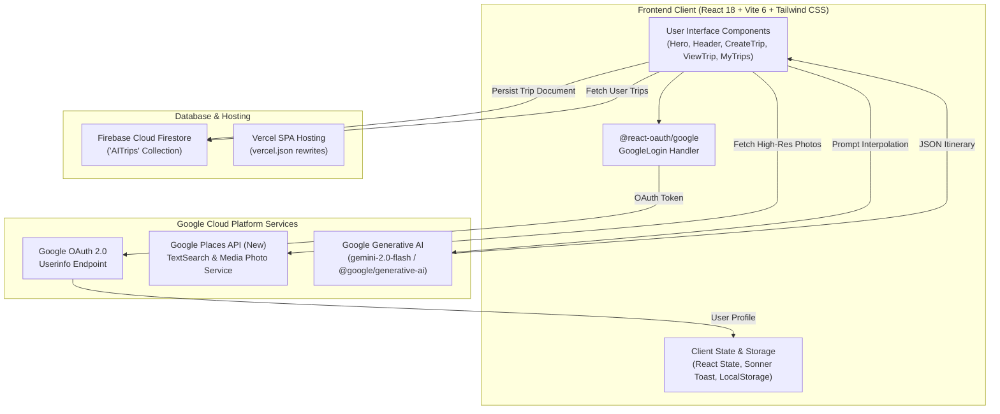
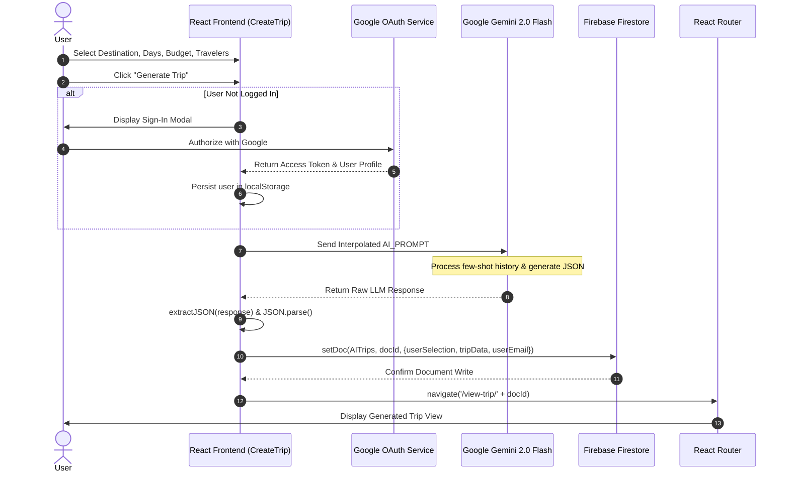
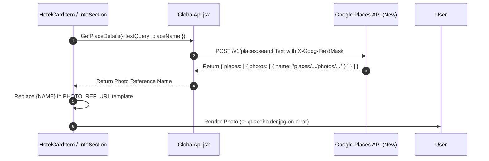

# Technical Documentation: Recommender System for Travel Planning (AI Travel Planner)

**Project Title:** AI-Powered Recommender System for Travel Planning  
**Academic Context:** Final Year Engineering Project (Created by Group 9)  
**Repository Name:** `recommender-system-for-travel-planning` / `final_year_project`  
**Version:** 1.0.0  
**Technology Framework:** React 18, Vite 6, Tailwind CSS 4, Google Gemini AI (2.0 Flash), Firebase Firestore, Google Places API (New), Google OAuth 2.0

---

## 1. Executive Summary & Purpose

The **AI Travel Planner** is an intelligent web application designed to eliminate the friction and decision fatigue associated with travel planning. By leveraging Google's **Gemini 2.0 Flash** Large Language Model (LLM) and Google's **Places API**, the platform generates tailored, multi-day travel itineraries and hotel recommendations in seconds.

### Key Capabilities:

- **Intelligent Preference Capture:** Collects user destination (via Google Places Autocomplete), trip length (up to 20 days), budget tier (_Cheap_, _Moderate_, _Luxury_), and traveler demographic (_Solo_, _Couple_, _Family_, _Friends_).
- **In-Context Few-Shot LLM Generation:** Crafts structured travel plans adhering to strict JSON schemas, detailing day-by-day sightseeing activities, optimal visiting times, estimated transit durations, ticket prices, and geolocation coordinates.
- **Dynamic Imagery Enrichment:** Queries Google Places API (New) to fetch real-world photographs for destinations, hotels, and attractions on the fly.
- **Direct Navigation Integration:** Converts recommended venues and hotels into one-click Google Maps search URLs.
- **User Authentication & Trip Persistence:** Provides seamless Google OAuth 2.0 sign-in and stores generated itineraries in Google Firebase Cloud Firestore for cross-session access via a personal "My Trips" dashboard.

---

## 2. High-Level System Architecture

The application adopts a **Client-Side Single Page Application (SPA)** architecture communicating directly with managed cloud services and serverless APIs.



---

## 3. Technology Stack & Dependencies

### 3.1 Core Framework & Tooling

| Package                 | Version   | Purpose                                            |
| :---------------------- | :-------- | :------------------------------------------------- |
| **`react`**             | `^18.3.1` | Declarative component UI library                   |
| **`react-dom`**         | `^18.3.1` | React DOM renderer                                 |
| **`vite`**              | `^6.2.0`  | Next-generation frontend build tool and dev server |
| **`react-router-dom`**  | `^7.4.0`  | Client-side routing with `createBrowserRouter`     |
| **`@tailwindcss/vite`** | `^4.0.15` | Official Vite plugin for Tailwind CSS v4 engine    |
| **`tailwindcss`**       | `^4.0.15` | Modern utility-first CSS framework                 |
| **`eslint`**            | `^9.21.0` | Code quality and linting                           |

### 3.2 UI Primitives & Styling

| Package                                  | Version             | Purpose                                                                      |
| :--------------------------------------- | :------------------ | :--------------------------------------------------------------------------- |
| **`@radix-ui/react-dialog`**             | `^1.1.15`           | Accessible modal dialog for Google Sign-In                                   |
| **`@radix-ui/react-slot`**               | `^1.1.2`            | Polymorphic slot utility for modular component composition                   |
| **`@base-ui/react`** / **`radix-ui`**    | `^1.3.0` / `^1.4.3` | Accessible UI foundational primitives                                        |
| **`lucide-react`**                       | `^0.483.0`          | Iconography suite for travel, import, and utility icons                      |
| **`react-icons`**                        | `^5.5.0`            | Third-party icons (e.g., `FcGoogle`, `AiOutlineLoading3Quarters`, `IoShare`) |
| **`animate.css`** / **`tw-animate-css`** | `^4.1.1` / `^1.2.4` | CSS animation library for entrance and hero transitions                      |
| **`sonner`**                             | `^2.0.5`            | Toast notification manager                                                   |
| **`clsx`** & **`tailwind-merge`**        | `^2.1.1` & `^3.0.2` | Utility for dynamically composing conditional Tailwind classes               |

### 3.3 Backend, AI & External Integrations

| Package                                | Version   | Purpose                                                    |
| :------------------------------------- | :-------- | :--------------------------------------------------------- |
| **`@google/generative-ai`**            | `^0.24.1` | Official Google Gemini SDK for JavaScript/TypeScript       |
| **`@google/genai`**                    | `^1.40.0` | Next-generation Google GenAI SDK (demo integration)        |
| **`firebase`**                         | `^12.7.0` | Firebase Web SDK (Cloud Firestore DB)                      |
| **`@react-oauth/google`**              | `^0.13.4` | Google Identity Services OAuth 2.0 wrapper                 |
| **`react-google-places-autocomplete`** | `^4.1.0`  | Google Places Autocomplete dropdown input                  |
| **`axios`**                            | `^1.13.6` | Promise-based HTTP client for Places API & Google UserInfo |

---

## 4. Directory & File Structure

```
final_year_project/
├── public/
│   ├── bgimg.png                      # Hero section background banner image
│   ├── logo.jpeg                      # Primary project logo
│   ├── logo1.jpeg                     # Alternative secondary logo
│   └── placeholder.jpg                # Fallback image when Google Places photo is unavailable
├── src/
│   ├── assets/
│   │   └── react.svg                  # Vite/React default asset
│   ├── components/
│   │   ├── custom/
│   │   │   ├── Header.jsx             # Global navigation bar, auth trigger, and user profile popover
│   │   │   └── Hero.jsx               # Landing page hero banner with CTA button
│   │   └── ui/
│   │       ├── button.jsx             # Reusable button variant component (CVA + Radix Slot)
│   │       ├── dialog.jsx             # Modal dialog component for Google authentication
│   │       ├── input.jsx              # Styled form input field
│   │       └── popover.jsx            # Popover menu component for user logout
│   ├── constants/
│   │   └── options.jsx                # Traveler options, Budget tiers, and Master AI Prompt template
│   ├── create-trip/
│   │   └── index.jsx                  # Trip creation form, validation, Gemini prompt caller & Firestore saver
│   ├── lib/
│   │   └── utils.js                   # Class merging helper (`cn` using clsx and tailwind-merge)
│   ├── my-trips/
│   │   ├── components/
│   │   │   └── UserTripCardItem.jsx   # Individual trip preview card with async photo lookup
│   │   └── index.jsx                  # User's saved trips gallery queried from Firestore
│   ├── service/
│   │   ├── AIModel.jsx                # Gemini 2.0 Flash configuration, system chat session & few-shot history
│   │   ├── Demo1.jsx                  # Experimental integration script for @google/genai SDK
│   │   ├── firebaseConfig.jsx         # Firebase app initialization and Firestore DB instance export
│   │   └── GlobalApi.jsx              # Google Places API (New) endpoints and photo resolution helper
│   ├── view-trip/
│   │   ├── [tripId]/
│   │   │   └── index.jsx              # Master trip details route, pulls document from Firestore by ID
│   │   └── components/
│   │       ├── Footer.jsx             # Page footer with Group 9 credits
│   │       ├── HotelCardItem.jsx      # Hotel card item linking out to Google Maps with dynamic photo
│   │       ├── Hotels.jsx             # Grid wrapper for recommended hotels
│   │       ├── InfoSection.jsx        # Destination hero banner, tags (days, budget, travelers) & share button
│   │       ├── PlaceCardItem.jsx      # Attraction card item with travel time, details & Maps link
│   │       └── PlacesToVisit.jsx      # Day-by-day itinerary view with daily plans and time recommendations
│   ├── App.css                        # App-specific CSS rules
│   ├── App.jsx                        # Root landing page rendering Header and Hero
│   ├── index.css                      # Tailwind v4 theme, font variables, and base styles
│   └── main.jsx                       # Application entry point with BrowserRouter & GoogleOAuthProvider
├── .env.local                         # Environment credentials (API keys and OAuth Client ID)
├── .gitignore                         # Git exclusion rules
├── components.json                    # Shadcn/ui component generator configuration
├── eslint.config.js                   # Flat ESLint rules configuration
├── index.html                         # SPA HTML entry point
├── jsconfig.json                      # Path aliases definition (`@/*` mapping to `./src/*`)
├── package.json                       # NPM dependencies, metadata, and scripts
├── vercel.json                        # Vercel SPA routing rewrite configuration
└── vite.config.js                     # Vite build configuration with Tailwind and path aliases
```

---

## 5. Detailed Component & Module Breakdown

### 5.1 Application Entry (`src/main.jsx`)

- Initialized via `ReactDOM.createRoot`.
- Wraps the entire application inside:
  - `<StrictMode>`: React development diagnostics.
  - `<GoogleOAuthProvider clientId={...}>`: Supplies Google OAuth context to all descendant components.
  - `<Header />`: Rendered globally above all routed views.
  - `<Toaster />`: Renders global Sonner toast notifications.
  - `<RouterProvider router={router} />`: Manages browser routing.

#### Defined Route Table:

| Route Path           | Element Component                                   | Description                                                 |
| :------------------- | :-------------------------------------------------- | :---------------------------------------------------------- |
| `/`                  | `<App />` (`src/App.jsx`)                           | Landing page containing `<Hero />`.                         |
| `/create-trip`       | `<CreateTrip />` (`src/create-trip/index.jsx`)      | Multi-input wizard for itinerary configuration.             |
| `/view-trip/:tripId` | `<Viewtrip />` (`src/view-trip/[tripId]/index.jsx`) | Detailed trip viewer loading data by Firestore document ID. |
| `/my-trips`          | `<MyTrips />` (`src/my-trips/index.jsx`)            | Dashboard listing all trips saved by the current user.      |

---

### 5.2 Header & Authentication Module (`src/components/custom/Header.jsx`)

- **State Management:**
  - Reads stored user session from `localStorage.getItem("user")`.
  - Manages `openDialog` state for Google Sign-In prompt.
- **Google OAuth Login Flow:**
  - Uses `useGoogleLogin` hook from `@react-oauth/google`.
  - On authorization token receipt, makes an HTTP GET request to `https://www.googleapis.com/oauth2/v1/userinfo`.
  - Saves the resulting user profile object (`id`, `name`, `email`, `picture`) into `localStorage` under key `'user'`.
  - Automatically triggers a page refresh to update state.
- **User Actions:**
  - When logged out: Displays a "Sign In" button triggering the Google OAuth modal.
  - When logged in: Displays "+ Create Trip", "My Trips", and the user's profile avatar.
  - Profile Avatar Popover: Includes a "Logout" action that invokes `googleLogout()`, executes `localStorage.clear()`, and reloads the application.

---

### 5.3 Landing Hero Section (`src/components/custom/Hero.jsx`)

- Renders an immersive fullscreen background visual (`/bgimg.png`) with a semi-transparent dark glassmorphism overlay (`bg-black/40 backdrop-blur-[3px]`).
- Includes animated headings via `animate.css` (`animate__fadeInUp`).
- Direct Call-to-Action (CTA) button linking to `/create-trip`.

---

### 5.4 Trip Generation Engine (`src/create-trip/index.jsx`)

This component is the core workflow driver:

1. **Form State Collection:**
   - `Location`: Retrieved via `<GooglePlacesAutocomplete />` using `import.meta.env.VITE_GOOGLE_PLACE_API_KEY`.
   - `NoOfDays`: Numeric input specifying the duration.
   - `Budget`: Selected from predefined options (`Cheap`, `Moderate`, `Luxury`).
   - `Traveler`: Selected from predefined group sizes (`1`, `2`, `3 to 5 People`, `5 to 10 People`).
2. **Validation Rules:**
   - Verifies user authentication (`localStorage.getItem('user')`). If null, opens Google Sign-In dialog.
   - Verifies all four parameters are populated; displays toast warning if incomplete.
   - Restricts trip duration: if `NoOfDays > 20`, displays an error toast.
3. **Prompt Composition:**
   - Interpolates user inputs into `AI_PROMPT` (from `src/constants/options.jsx`).
4. **LLM Query & Response Sanitization:**
   - Submits prompt to `chatSession.sendMessage(FINAL_PROMPT)` via Gemini 2.0 Flash.
   - Passes response text to `extractJSON()`:
     ```javascript
     const extractJSON = (text) => {
       const firstBrace = text.indexOf("{");
       const lastBrace = text.lastIndexOf("}");
       if (firstBrace === -1 || lastBrace === -1) {
         throw new Error("No JSON found in AI response");
       }
       return text.substring(firstBrace, lastBrace + 1);
     };
     ```
   - Parses cleaned text into a native JavaScript object (`parsedTripData`).
5. **Persistence in Firestore:**
   - Generates unique ID via `Date.now().toString()`.
   - Executes `setDoc(doc(db, "AITrips", docId), { userSelection, tripData, userEmail, id })`.
   - Navigates client to `/view-trip/${docId}`.

---

### 5.5 AI Model & In-Context Learning Configuration (`src/service/AIModel.jsx`)

- **SDK:** `@google/generative-ai` (`GoogleGenerativeAI`).
- **Model:** `gemini-2.0-flash`.
- **In-Context Few-Shot Training:**
  - Seeds the chat history with a full realistic user query for Las Vegas and a model response that formats hotel options and day-by-day itineraries in explicit JSON.
  - This ensures Gemini consistently outputs predictable JSON matching the client application's expectations without hallucinated schema keys.

---

### 5.6 View Trip Module (`src/view-trip/[tripId]/index.jsx`)

- Extracts `:tripId` from URL route using `useParams()`.
- Queries Firestore via `getDoc(doc(db, "AITrips", tripId))`.
- Renders four modular subcomponents:
  1. `<InfoSection trip={trip} />`: Shows location name, duration tag, budget tag, traveler count tag, and social share button. Resolves high-resolution destination photo via `GetPlaceDetails`.
  2. `<Hotels trip={trip} />`: Renders hotel cards in a responsive grid (`grid-cols-2 md:grid-cols-3 xl:grid-cols-4`).
  3. `<PlacesToVisit trip={trip} />`: Groups attractions by day (`Day 1`, `Day 2`, etc.), displaying recommended visiting time, activity description, travel duration, and clickable cards.
  4. `<Footer />`: Displays project group accreditation.

---

### 5.7 Dynamic Media & Google Places Integration (`src/service/GlobalApi.jsx`)

To avoid broken static image links from LLMs, all imagery is resolved dynamically using the **Google Places API (New)**.

#### Endpoint Configuration:

- **Base URL:** `https://places.googleapis.com/v1/places:searchText`
- **HTTP Method:** `POST`
- **Request Headers:**
  - `Content-Type: application/json`
  - `X-Goog-Api-Key: VITE_GOOGLE_PLACE_API_KEY`
  - `X-Goog-FieldMask: places.photos,places.displayName,places.id`
- **Photo Media URL Template:**
  ```
  https://places.googleapis.com/v1/{NAME}/media?maxHeightPx=1500&maxWidthPx=1500&key={VITE_GOOGLE_PLACE_API_KEY}
  ```
- **Fallback Handling:** If Places API returns no valid photo references, components fall back to `/placeholder.jpg`.

---

### 5.8 Saved Trips Dashboard (`src/my-trips/index.jsx`)

- Reads user information from `localStorage`.
- Queries Firestore collection `"AITrips"` with filter:
  ```javascript
  query(collection(db, "AITrips"), where("userEmail", "==", user?.email));
  ```
- Renders animated pulsing skeletons (`bg-slate-200 animate-pulse`) while awaiting Firestore response.
- Renders responsive cards (`<UserTripCardItem />`) linking to `/view-trip/${trip.id}`.

---

## 6. End-to-End Sequence Diagrams

### 6.1 Trip Generation & Storage Flow



### 6.2 Dynamic Photo Resolution Flow



---

## 7. Data Architecture & Schemas

### 7.1 Firestore Database Schema

**Collection Name:** `AITrips`  
**Document ID:** `String` (Epoch timestamp, e.g. `"1741584000000"`)

| Field Path               | Data Type           | Description                                                   |
| :----------------------- | :------------------ | :------------------------------------------------------------ |
| `id`                     | `string`            | Unique identifier of the trip (matches document ID).          |
| `userEmail`              | `string`            | Email address of the user who generated the trip.             |
| `userSelection`          | `object`            | Form input snapshot entered by the user.                      |
| `userSelection.Location` | `object`            | Place object containing `label` (e.g. `"Paris, France"`).     |
| `userSelection.NoOfDays` | `string` / `number` | Trip duration in days.                                        |
| `userSelection.Budget`   | `string`            | Selected budget option (`"Cheap"`, `"Moderate"`, `"Luxury"`). |
| `userSelection.Traveler` | `string`            | Selected party size (`"1"`, `"2"`, `"3 to 5 People"`, etc.).  |
| `tripData`               | `object`            | Parsed itinerary payload returned by Google Gemini.           |

### 7.2 Generated Itinerary Data Contract (`tripData`)

```json
{
  "TravelPlan": {
    "Location": "string (e.g. Las Vegas, Nevada)",
    "Duration": "string (e.g. 3 Days)",
    "Budget": "string (e.g. Cheap/Budget-Friendly)",
    "TargetAudience": "string (e.g. Couple)",
    "HotelOptions": [
      {
        "HotelName": "string",
        "HotelAddress": "string",
        "Price": "string (e.g. $30 - $75 per night)",
        "HotelImageUrl": "string",
        "GeoCoordinates": {
          "Latitude": 36.0906,
          "Longitude": -115.1722
        },
        "Rating": 4.2,
        "Description": "string"
      }
    ],
    "Itinerary": [
      {
        "Day": 1,
        "DayTheme": "string",
        "BestTimeToVisit": "string (e.g. Morning to Night)",
        "Plan": [
          {
            "PlaceName": "string",
            "PlaceDetails": "string",
            "PlaceImageUrl": "string",
            "GeoCoordinates": {
              "Latitude": 36.1125,
              "Longitude": -115.1767
            },
            "TicketPricing": "string (e.g. Free or $15)",
            "Rating": 4.8,
            "TravelTime": "string (e.g. 15-30 mins visit)"
          }
        ]
      }
    ]
  }
}
```

---

## 8. Environment Variables Specification

The application requires a `.env.local` file placed at the root of the project:

```env
# Google Gemini Generative AI API Key
VITE_GOOGLE_GEMINI_AI_API_KEY=your_gemini_api_key_here

# Google OAuth 2.0 Web Client ID
VITE_GOOGLE_AUTH_CLIENT_ID=your_google_oauth_client_id_here.apps.googleusercontent.com

# Google Places API Key (Autocomplete, TextSearch & Media)
VITE_GOOGLE_PLACE_API_KEY=your_google_places_api_key_here
```

### Purpose & Configuration Guide:

1. **`VITE_GOOGLE_GEMINI_AI_API_KEY`**: Acquired from [Google AI Studio](https://aistudio.google.com/). Enables the `chatSession.sendMessage` interface on Gemini 2.0 Flash.
2. **`VITE_GOOGLE_AUTH_CLIENT_ID`**: Created in the [Google Cloud Console](https://console.cloud.google.com/) under **APIs & Services > Credentials > OAuth 2.0 Client IDs**. Add `http://localhost:5173` to **Authorized JavaScript origins**.
3. **`VITE_GOOGLE_PLACE_API_KEY`**: Created in Google Cloud Console with the **Places API (New)** enabled.

---

## 9. Installation & Deployment Guide

### 9.1 Local Development Setup

1. **Clone or Extract Project:**

   ```bash
   cd final_year_project
   ```

2. **Install Dependencies:**

   ```bash
   npm install
   ```

3. **Configure Environment Variables:**
   Create `.env.local` in the project root and populate the keys as detailed in Section 8.

4. **Launch Vite Development Server:**

   ```bash
   npm run dev
   ```

   Open `http://localhost:5173` in your browser.

5. **Linting Check:**
   ```bash
   npm run lint
   ```

### 9.2 Production Build

```bash
npm run build
```

This produces an optimized production bundle inside the `dist/` directory.

### 9.3 Deployment (Vercel)

The repository contains `vercel.json` configured for client-side SPA routing:

```json
{
  "rewrites": [{ "source": "/(.*)", "destination": "/" }]
}
```

This ensures direct URLs (e.g. `/view-trip/1741584000000` or `/my-trips`) resolve correctly without returning 404 HTTP errors.

---

## 10. Security Analysis & Engineering Recommendations

### 10.1 Vulnerability Review

1. **Client-Exposed Secrets:**
   - In Vite applications, all environment variables prefixed with `VITE_` are bundled directly into client-accessible JavaScript.
   - **Recommendation:** Implement a lightweight serverless backend proxy (e.g. Vercel Serverless Functions or Firebase Cloud Functions) to invoke the Gemini and Places APIs so that private keys remain secure on the server side.
2. **Firebase Firestore Security Rules:**
   - Ensure Firestore security rules authenticate user read/write access. For example:
     ```javascript
     rules_version = '2';
     service cloud.firestore {
       match /databases/{database}/documents {
         match /AITrips/{tripId} {
           allow read: if true;
           allow create: if request.auth != null || request.resource.data.userEmail != null;
           allow update, delete: if request.auth != null && request.auth.token.email == resource.data.userEmail;
         }
       }
     }
     ```
3. **Robustness of AI JSON Parsing:**
   - The current `extractJSON` function isolates the substring between the first `{` and last `}`.
   - **Recommendation:** Leverage Gemini's native `responseSchema` or structured outputs feature in `@google/generative-ai` to enforce 100% valid JSON directly at the inference layer.

---

## 11. Conclusion & Academic Significance

The **Recommender System for Travel Planning** demonstrates a successful synthesis of modern full-stack web engineering, Large Language Models, and real-time geographic data services. It delivers a fast, responsive, and intuitive tool capable of generating rich travel itineraries with zero manual curation overhead.
